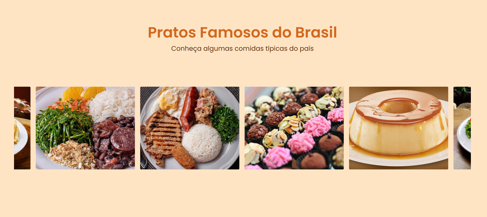

# 🍽️ Pratos Típicos do Brasil — Carrossel Animado

Projeto de uma página temática sobre a culinária brasileira, desenvolvido com **HTML5 e CSS3** como parte de uma atividade prática do curso PROA.

O projeto tem como objetivo explorar a criação de animações e componentes visuais interativos utilizando CSS, apresentando pratos tradicionais da culinária brasileira por meio de um carrossel de imagens com movimentação automática e contínua.

## 🖥️ Prévia do projeto

  

🔗 **[Acesse o projeto online](https://gabrielc0liveira.github.io/Projeto25Proa-PratosTipicosdoBrasil/)**

## Funcionalidades e características

- Página temática dedicada à culinária brasileira.
- Carrossel horizontal com movimentação automática e contínua.
- Exibição de imagens de pratos típicos e sobremesas brasileiras.
- Apresentação de pratos como feijoada, virado à paulista, brigadeiro e pudim.
- Animação infinita desenvolvida exclusivamente com CSS.
- Duplicação dos grupos de imagens para criar o efeito de continuidade.
- Organização dos cartões utilizando Flexbox.
- Imagens ajustadas proporcionalmente com `object-fit: cover`.
- Ocultação visual da barra de rolagem horizontal.
- Cartões com dimensões padronizadas e bordas arredondadas.
- Identidade visual com cores quentes inspiradas na culinária.
- Tipografia personalizada utilizando a fonte Poppins.
- Estrutura desenvolvida sem utilização de JavaScript.

## Tecnologias utilizadas

- **HTML5:** estruturação da página, organização dos grupos de imagens e criação dos cartões.
- **CSS3:** estilização, animações, posicionamento e configuração do carrossel.
- **Flexbox:** distribuição horizontal dos cartões e alinhamento dos elementos.
- **CSS Animations:** criação da movimentação contínua utilizando `@keyframes`.
- **Google Fonts:** utilização da fonte Poppins.

## Aprendizados

Durante o desenvolvimento, foram praticados conceitos como:

- Estruturação de uma página temática utilizando HTML.
- Organização de imagens em cartões reutilizáveis.
- Criação de layouts horizontais utilizando `display: flex`.
- Controle de espaçamento entre elementos com `gap`.
- Utilização de `flex-shrink: 0` para impedir a redução dos grupos de imagens.
- Criação de áreas com rolagem horizontal utilizando `overflow-x: auto`.
- Personalização e ocultação de barras de rolagem com `::-webkit-scrollbar`.
- Definição de dimensões utilizando `width` e `height`.
- Ajuste de imagens com `object-fit: cover`.
- Utilização de `overflow: hidden` para limitar o conteúdo dos cartões.
- Aplicação de bordas arredondadas com `border-radius`.
- Criação de animações personalizadas utilizando `@keyframes`.
- Aplicação da propriedade `animation` para controlar duração, repetição e velocidade.
- Utilização de `linear` para manter a velocidade constante da animação.
- Aplicação de `infinite` para repetir a animação continuamente.
- Movimentação horizontal de elementos utilizando a propriedade `translate`.
- Duplicação de elementos HTML para criar a aparência de um carrossel infinito.
- Utilização do atributo `aria-hidden` para ocultar conteúdos duplicados de tecnologias assistivas.
- Centralização de títulos e textos com `text-align`.
- Personalização de cores utilizando propriedades CSS.
- Desenvolvimento de animações visuais sem dependência de JavaScript.

## 📂 Como executar o projeto

🔗 **[Acesse o projeto online](https://gabrielc0liveira.github.io/Projeto25Proa-PratosTipicosdoBrasil/)**

---

Desenvolvido por **Gabriel Oliveira** como parte das atividades práticas do PROA.
